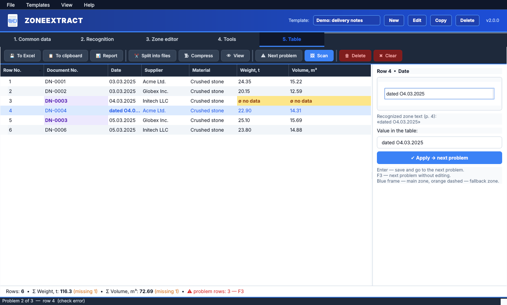
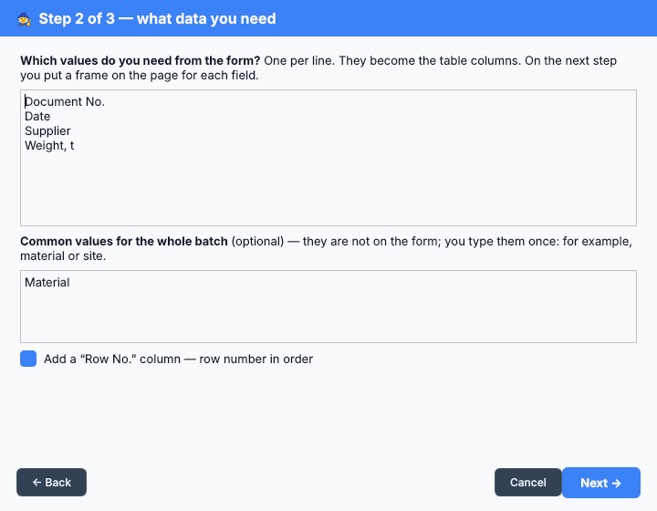
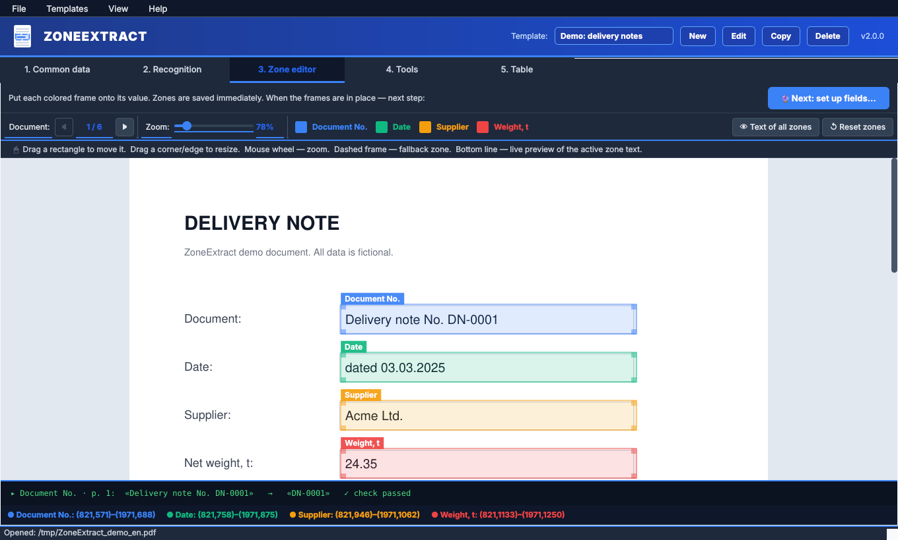
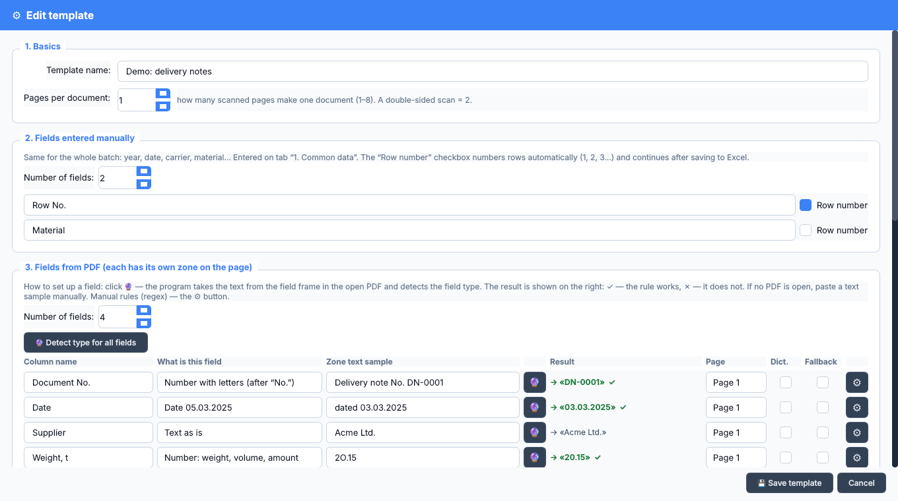

<p align="center">
  
</p>

<h1 align="center">ZoneExtract</h1>

<p align="center">
  <b>Turn stacks of scanned forms into a clean table.</b><br>
  Mark once where each value sits on the page — ZoneExtract reads it from every PDF in the batch,
  checks it and highlights what needs a human look.
</p>

<p align="center">
  
  
  
  
  <a href="README.ru.md"></a>
</p>

---

## What problem it solves

You have a pile of paper documents of the same kind — delivery notes, waybills, invoices,
weighing tickets, acts. Somebody has to type the document number, date, supplier and weight
of each one into Excel. ZoneExtract does the typing:

```
 Scans ──► OCR ─────────────► PDF with text ──► ZoneExtract ──────────► Table ──► Excel / clipboard
          (FineReader,                          frame on the page       checks:
           OCRmyPDF, …)                         → column in the table   empty, wrong format, duplicate
```

It is a desktop app, works offline, and needs no programming. One template per form type;
after that a batch of 200 documents takes a couple of minutes, most of which is fixing the few
cells it flags.

## Features

- **Visual zone editor** — drag colored frames over the page; the text inside each frame is shown live.
- **Automatic field type detection (🔮)** — the program reads the text in the frame and decides
  whether it is a number, a date, a document code, a license plate…
- **Checks and highlighting** — empty cells (yellow), wrong format (red), repeated document numbers (purple).
- **Fix with the scan in view** — press <kbd>F3</kbd>, see the cropped scan next to the cell,
  type the value, <kbd>Enter</kbd> → next problem.
- **OCR clean-up** — look-alike letters inside numbers (`2O,15` → `20,15`), dates in words,
  net weight in kg → tonnes, and more.
- **Calculated fields** — e.g. `Volume = [Weight] / 1.6`.
- **Manual fields and row numbering** — values common to the batch; numbering continues between batches.
- **Excel export without damage** — rows are appended to an existing workbook, numbers stay numbers,
  duplicates already in the file are detected.
- **Custom report** — your own column set, copied for pasting into Google Sheets.
- **Multi-page documents** (up to 8 pages), **folders of PDFs** as one batch, **dictionaries**
  (fuzzy matching against a reference list), **split** a batch into one PDF per document, **compress** PDFs.
- **Russian and English** interface, 5 color themes.

## Quick start

```bash
pip install PySide6 PyMuPDF pandas openpyxl
python zoneextract.py
```

On the first start choose **▶ Demo**. The program generates a sample PDF with six delivery notes
and a ready template. Click **2. Recognition → ▶ Extract data** and look at the table:
three documents have problems on purpose.

> **Windows without Python?** Download `ZoneExtract.exe` from the
> [Releases](../../releases) page — no installation needed.
> Windows may show “Windows protected your PC” for a new unsigned program:
> click **More info → Run anyway**.

## Your first template (5 steps)

1. **Templates → First template wizard.** Choose a sample PDF and type the names of the values
   you need, one per line.

   

2. **Tab “3. Zone editor”.** Drag each colored frame onto its value. The bottom line shows the
   text the program sees in the active frame.

   

3. **“🔮 Next: set up fields…” → “🔮 Detect type for all fields”.** A ✓ on the right means the rule
   works for the sample. Save the template.

   

4. **Tab “2. Recognition” → “▶ Extract data”.**
5. **Tab “5. Table”** — fix the highlighted cells (<kbd>F3</kbd>), then **To Excel** or **Report**.

Next time: choose the template → open the PDF (or a folder of PDFs) → **Extract**.

## Field types

| Type | Text in the frame | Result |
|---|---|---|
| Text as is | `Acme Ltd.` | `Acme Ltd.` |
| Number (weight, volume, amount) | `Gross weight 4O.1 t` | `40.1` |
| Number without leading zeros | `ORDER No. 00000012345` | `12345` |
| Number with letters (after “No.”) | `Invoice No. INV-000123 dated 05.03` | `INV-000123` |
| Date | `dated 05.03.2025` | `05.03.2025` |
| Date in words | `5 March 2025` | `05.03.2025` |
| Net, kg → tonnes | `Net weight: 51470 kg` | `51.47` |
| Russian license plate | `T 123 OP 178` | `Т123ОР178` |
| Russian full name | `Иванов Иван Петрович, паспорт …` | `Иванов И.П.` |
| INN (Russian tax ID) | `INN 7701234567` | `7701234567` |
| Custom | your own regex for cleaning and for the check | |

## Requirements and notes

- **The PDF must have a text layer.** ZoneExtract does not do OCR itself — it reads the text that
  an OCR program put into the PDF. Free option: [OCRmyPDF](https://github.com/ocrmypdf/OCRmyPDF);
  commercial: ABBYY FineReader (“Save as → Searchable PDF”). Scan at 300 DPI.
- Templates are stored in `templates_config.json`, UI settings in `ui_settings.json`,
  both next to the program. Copy `templates_config.json` to share templates with colleagues.
- Python 3.9 or newer. Main platform: Windows 10/11; also runs on Linux (macOS should work too).

## Build a Windows .exe

```bash
pip install pyinstaller
pyinstaller --onefile --windowed --name ZoneExtract zoneextract.py
```

The file appears in `dist/`. Templates are saved next to the `.exe`.
The repository also has a GitHub Actions workflow that builds the `.exe` and attaches it to a
release when you push a tag like `v2.0.0`.

## Adding a language

All UI strings go through `tr()`. The English dictionary `_EN` is at the end of `zoneextract.py`.
To add a language, add a similar dictionary and its code to `LANGUAGES`. Pull requests are welcome.

## License

[MIT](LICENSE) — free for personal and commercial use.
