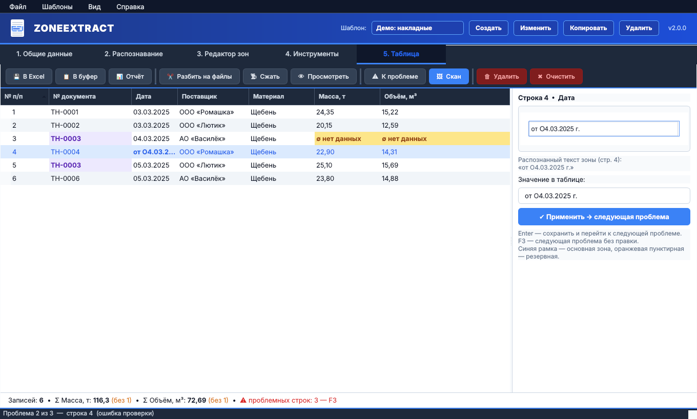
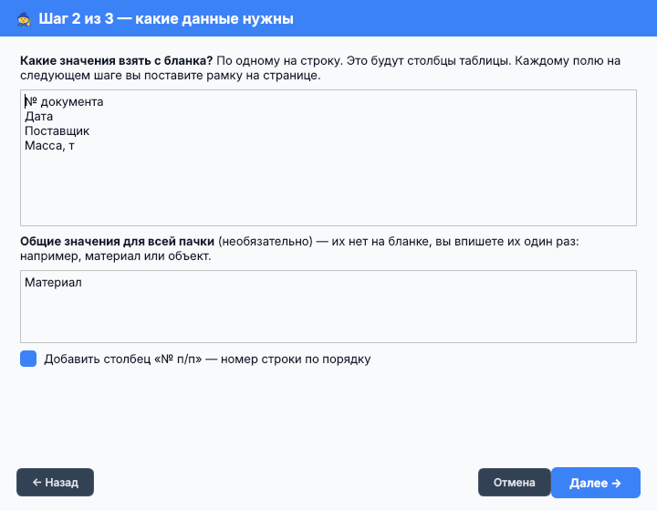
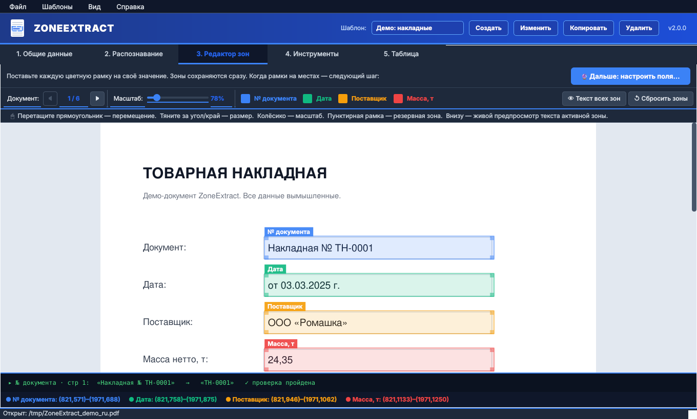
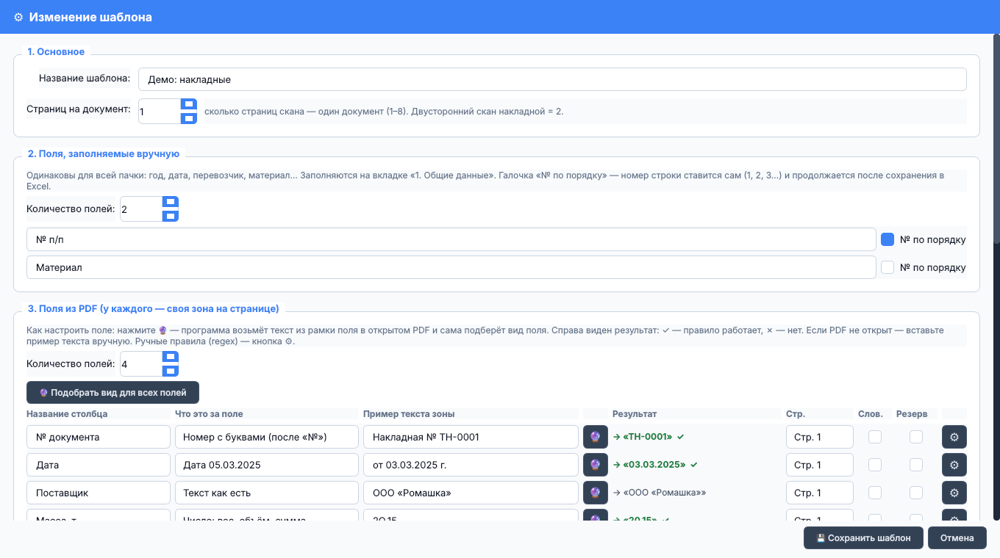

<p align="center">
  
</p>

<h1 align="center">ZoneExtract</h1>

<p align="center">
  <b>Пачка сканов бланков → готовая таблица.</b><br>
  Один раз покажите, где на странице лежит каждое значение, — ZoneExtract возьмёт его из каждого
  документа пачки, проверит и подсветит то, что нужно посмотреть глазами.
</p>

<p align="center">
  
  
  
  
  <a href="README.md"></a>
</p>

---

## Какую задачу решает

Есть пачка однотипных бумаг — товарные накладные, ТН/ТТН, путевые листы, акты, талоны
взвешивания. Кто-то должен перебить в Excel номер, дату, поставщика и массу с каждой.
ZoneExtract делает это за человека:

```
 Сканы ──► Распознавание ──► PDF с текстом ──► ZoneExtract ──────────► Таблица ──► Excel / буфер
          (FineReader,                         рамка на странице        проверка:
           OCRmyPDF…)                          → столбец таблицы        пусто, не тот формат, повтор
```

Это настольная программа: работает без интернета, программировать не нужно. На каждый вид
бланка — один шаблон. Дальше пачка из 200 документов обрабатывается за пару минут, и большая
часть этого времени — правка нескольких подсвеченных ячеек.

## Возможности

- **Визуальный редактор зон** — цветные рамки на странице; текст внутри рамки виден сразу.
- **Автоподбор вида поля (🔮)** — программа читает текст из рамки и сама понимает: число, дата,
  номер документа, гос. номер…
- **Проверка и подсветка** — пусто (жёлтый), не тот формат (красный), повтор номера (фиолетовый).
- **Правка со сканом перед глазами** — <kbd>F3</kbd>, рядом с ячейкой кусок скана, впишите
  значение, <kbd>Enter</kbd> → следующая проблема.
- **Исправление ошибок распознавания** — буквы-двойники в числах (`2О,15` → `20,15`), дата словами,
  нетто в кг → тонны, гос. номера РФ, ФИО → «Фамилия И.О.».
- **Вычисляемые поля** — например, `Объём = [Масса] / 1,6`.
- **Ручные поля и нумерация строк** — общие значения пачки; нумерация продолжается между пачками.
- **Аккуратная запись в Excel** — строки дописываются в существующий файл, числа остаются
  числами, повторы с уже записанными номерами находятся.
- **Свой отчёт** — нужный набор колонок для вставки в Google Таблицы.
- **Многостраничные документы** (до 8 страниц), **папка с PDF** как одна пачка, **словари**
  (нечёткое сопоставление со справочником), **разбивка** пачки на PDF по документам, **сжатие** PDF.
- Интерфейс **на русском и английском**, 5 цветовых тем.

## Быстрый старт

```bash
pip install PySide6 PyMuPDF pandas openpyxl
python zoneextract.py
```

При первом запуске выберите **▶ Демо-пример**. Программа создаст тестовый PDF из шести накладных
и готовый шаблон. Нажмите **2. Распознавание → ▶ Извлечь данные** и посмотрите таблицу:
в трёх документах специально есть ошибки.

> **Windows без Python?** Скачайте `ZoneExtract.exe` на странице [Releases](../../releases) —
> установка не нужна.
> Windows может показать «Система Windows защитила ваш компьютер» — так бывает с новыми
> неподписанными программами. Нажмите **Подробнее → Выполнить в любом случае**.

## Первый шаблон — 5 шагов

1. **Шаблоны → Мастер: первый шаблон.** Выберите PDF-образец и впишите названия нужных значений,
   по одному на строку.

   

2. **Вкладка «3. Редактор зон».** Перетащите каждую цветную рамку на своё значение. Внизу — текст,
   который программа видит в активной рамке.

   

3. **«🔮 Дальше: настроить поля…» → «🔮 Подобрать вид для всех полей».** ✓ справа — правило
   работает на примере. Сохраните шаблон.

   

4. **Вкладка «2. Распознавание» → «▶ Извлечь данные».**
5. **Вкладка «5. Таблица»** — исправьте подсвеченное (<kbd>F3</kbd>), затем **В Excel** или **Отчёт**.

В следующий раз: выбрать шаблон → открыть PDF (или папку с PDF) → **Извлечь**.

## Виды полей

| Вид | Текст в рамке | Результат |
|---|---|---|
| Текст как есть | `ООО «Ромашка»` | `ООО «Ромашка»` |
| Число: вес, объём, сумма | `Масса груза 4О,1 т` | `40,1` |
| Номер без нулей впереди | `ОРДЕР № 00000012345` | `12345` |
| Номер с буквами (после «№») | `Накладная № ТН-000123 от 05.03` | `ТН-000123` |
| Дата | `от 05.03.2025 г.` | `05.03.2025` |
| Дата словами | `«5» марта 2025 г.` | `05.03.2025` |
| Нетто, кг → тонны | `Нетто: 51 470 кг` | `51,47` |
| Гос. номер РФ | `T 123 OP 178` (латиница) | `Т123ОР178` |
| Гос. номер тягача | `Т123ОР178 / АВ1234 78` | `Т123ОР178` |
| ФИО → Фамилия И.О. | `Иванов Иван Петрович, паспорт …` | `Иванов И.П.` |
| ИНН | `ИНН 7701234567` | `7701234567` |
| Своё правило | свой regex очистки и проверки | |

## Что нужно знать

- **В PDF должен быть текстовый слой.** ZoneExtract не распознаёт сканы сам — он читает текст,
  который туда положила программа распознавания. Бесплатно: [OCRmyPDF](https://github.com/ocrmypdf/OCRmyPDF);
  платно: ABBYY FineReader («Сохранить как → PDF с возможностью поиска»). Сканируйте с 300 DPI.
- Шаблоны хранятся в `templates_config.json`, настройки — в `ui_settings.json`, оба файла рядом
  с программой. Чтобы поделиться шаблонами с коллегой, передайте ему `templates_config.json`.
- Python 3.9 или новее. Основная платформа — Windows 10/11; работает и в Linux (macOS тоже должен).

## Сборка .exe для Windows

```bash
pip install pyinstaller
pyinstaller --onefile --windowed --name ZoneExtract zoneextract.py
```

Файл появится в папке `dist/`. Шаблоны сохраняются рядом с `.exe`.
В репозитории есть сценарий GitHub Actions: при публикации тега вида `v2.0.0` он сам собирает
`.exe` и прикладывает его к релизу.

## Лицензия

[MIT](LICENSE) — можно свободно использовать, в том числе на работе и в коммерческих целях.
